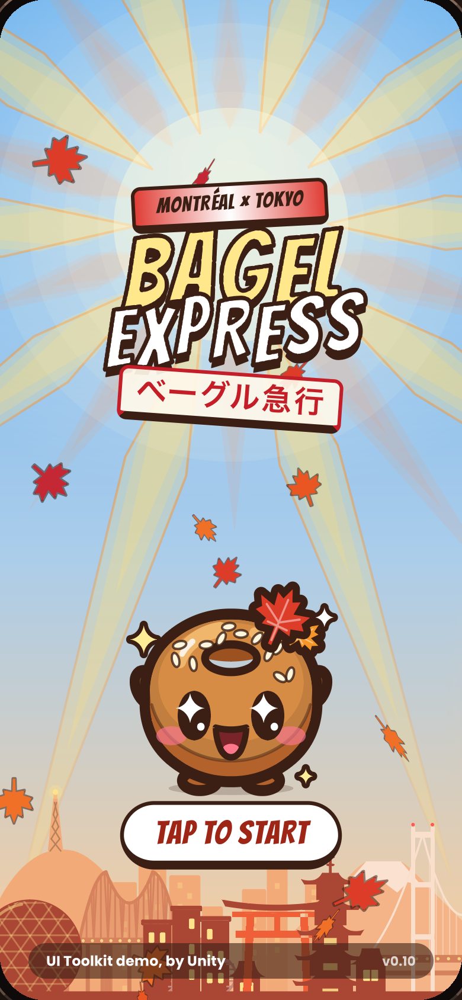
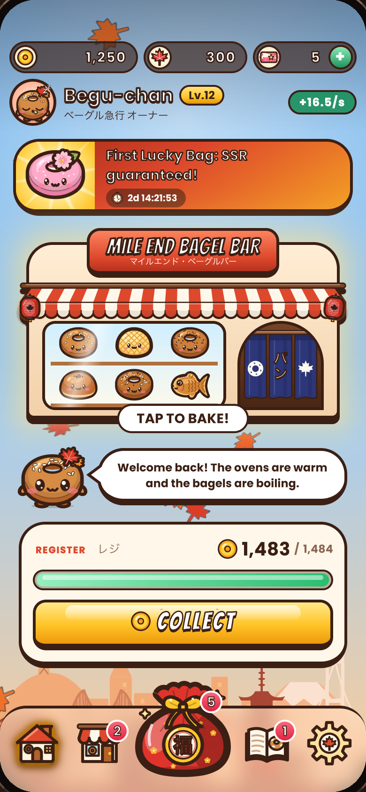
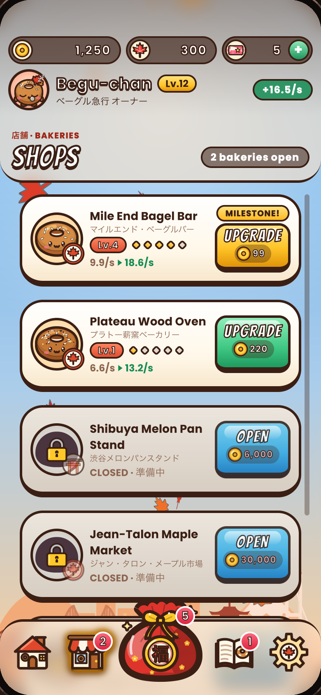
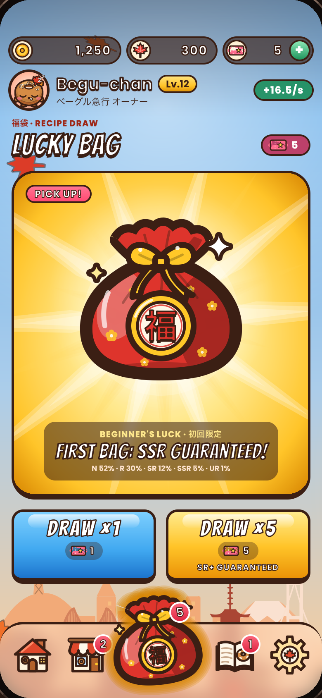
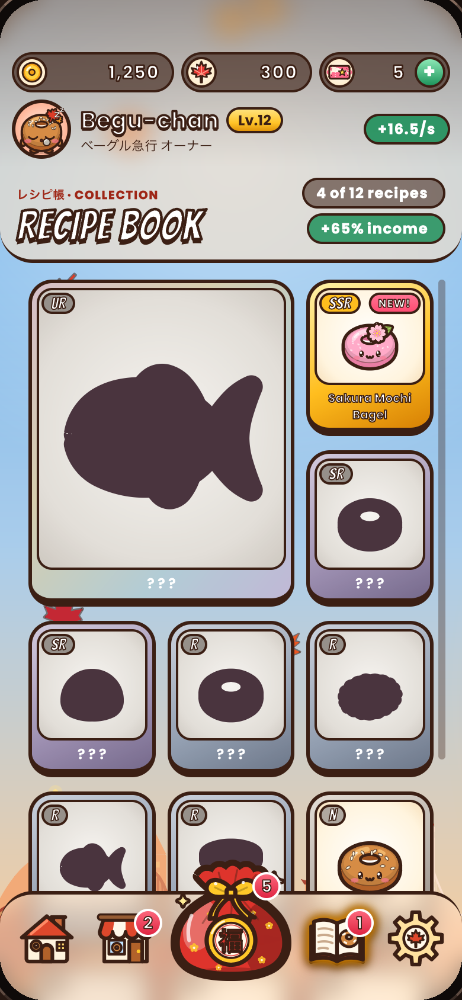

Tested against: **Unity 6.7 (6000.7.0b9 pre-release)**

# Bagel Express · ベーグル急行

<p align="center">
  
  
  
  
  
</p>

A Montréal × Tokyo idle bakery tycoon built entirely with **UI Toolkit**, to show what's new in it from Unity 6.4 to 6.7. It has no image or audio assets: the art is USS gradients, shadows and filters, SVG, Painter2D, mesh modifiers and a UI Shader Graph, and every sound is synthesized as it plays.

## Requirements

- **Unity 6.7:** 6000.7.0b9 or a later 6.7 release, from [Unity Hub](https://unity.com/download) or the Unity CLI. The game uses USS `box-shadow`, which 6000.7.0b8 doesn't have.
- The project uses UI Toolkit's experimental features (Grid layout, UI Components, accessibility for runtime panels). Their project settings are on, and the per-user ones are turned on each time the project opens.

## Run it

1. Open this folder: in Unity Hub with **Add › Add project from disk**, or with the Unity CLI:
   ```bash
   unity open .
   ```
2. Open `Assets/Scenes/Main.unity`, set the Game view to **Simulator** with a portrait iPhone, and press **Play**. Each Play session starts a new game.

## In the Editor

Under the **Bagel** menu:

- **Bagel UI:** every screen of the game live in one window, without Play mode.
- **Bagel Features:** each UI Toolkit feature the game uses, with a live sample, short snippets and the places in the game that use it, plus the ones it doesn't use.
- **Art Sampler:** all the art drawn with Painter2D.

The tests are in **Window › General › Test Runner** (EditMode and PlayMode).

## Builds

The project's build profiles (**File › Build Profiles**) cover macOS (Apple silicon), Windows, iOS, Android (ARM64, Android 8.0 or later) and the Web (WebGPU only, without sound). Each needs its Build Support module from Unity Hub › Installs.

The screenshots above are in `Docs/`; **Bagel › Dev › Update README Screenshots** takes them again. See [CHANGELOG.md](CHANGELOG.md) for what changed in each version.

## Contributions

At this time, we will not accept pull requests, GitHub review requests, or any other GitHub-hosted issue management requests. This might change in the future.

## License

Bagel Express is licensed under the Unity Companion License for Unity-dependent projects; see [LICENSE](LICENSE). The bundled fonts (Bangers, Poppins, Noto Sans JP) are under the SIL Open Font License 1.1; see [Third Party Notices.md](Third%20Party%20Notices.md).
